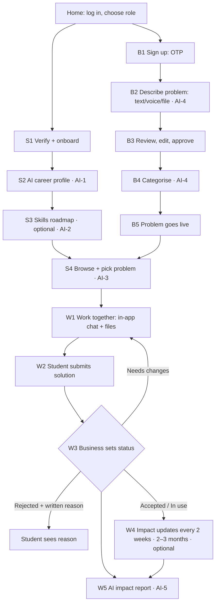
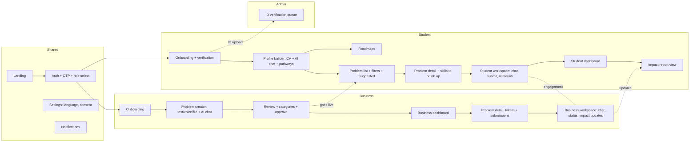

# Kadam: Complete Project Context and Component Map

Final version · 15 Nov 2026

> **For the AI reading this:** This file is the single source of truth for our hackathon project, **Kadam**. The team will use it to write a build prompt for Claude Code. Everything here is decided unless it's marked **Suggestion** or **Open**. Don't add features that are listed under "Not in the MVP." If something here conflicts or is unclear, flag it rather than guessing.

---

## 1. Where we are

- **Event:** AI hackathon. Each team writes its own problem statement and builds the solution itself.
- **Brief:** the problem must be one that college students face, or one in the area around their college.
- **Status:** our problem statement was accepted and **we qualified for Round 2**. Now we build.
- **Mindset:** this is an **MVP focused on ideation and innovation**. Judges are looking for a strong idea plus a working demo, not a production-ready platform. Prefer the simplest approach that works.

## 2. Name

**Kadam** (Hindi for "step"). Tagline: **"Take your first step."** Name and tagline read as one line: **"Kadam. Take your first step."** (Replaced "Real Problems, Real Impact, Real Careers" in round 2.)
Don't use the old placeholder name, "CampusCode."

## 3. The problem (student-first)

**Primary problem: career anxiety among college students.** Students graduate with degrees but without proof of what they can do. Employers want experience, and students can't get experience without a job.

Students hit three walls:
1. **No direction.** They don't know which careers fit them or which ones they could move into. Example: an engineering student curious about journalism has no structured way to test that interest.
2. **No real experience.** Internships are scarce. College projects are hypothetical, never used by a real organisation, and never measured.
3. **No roadmap.** Even with a target role in mind, they don't know which skills to learn, in what order, or how to prove them.

**The bonus side:** India's MSMEs, startups, NGOs and informal businesses have real problems they can't afford to solve. That unsolved work is exactly the experience students are missing.

**Stats from our submission:**
- The India Skills Report 2026 puts graduate employability at **56.35%**. This is a test-based benchmark.
- Graduate unemployment is **11.2%**, compared with 3.1% nationally (PLFS Annual Report 2025, via a secondary source).
- Among digitally hesitant MSMEs, **56%** cite a lack of technical skills (CMR study, reported by DQ India).

**Positioning:** Kadam is **not an internship portal** and not a job board. It's a platform for problem-solving projects judged on real outcomes.

## 4. Users

| Priority | Who | Notes |
|---|---|---|
| **Primary** | College students in **every stream** (engineering, commerce, arts, science) | Focus on universities with many streams. Includes students who want to move into a field outside their degree. |
| **Secondary** | MSMEs, SMEs, startups and NGOs across many sectors, plus informal businesses such as kirana stores | Many owners aren't tech-savvy but can read, and many prefer their own language. |
| **Internal** | Kadam admin | Reviews uploaded student IDs within 72 hours. |

---

## 5. Master workflow

### 5.1 Diagram



### 5.2 Entry
- **One login.** The user picks a role (Student or Business) and lands on that role's interface.
- The **UI language toggle** is on every screen and switches the whole interface: English, Hindi, Kannada, Tamil, Odia, Bengali, Gujarati and more.
- **Chat is assumed to be in English for the MVP.** There's no automatic chat translation.
- User **consent** is collected at sign-up.

### 5.3 Student side

**S1. Onboarding and verification**
- Basic details: name, college, course, year.
- Verification uses either route:
  - **College email OTP:** verifies the student instantly.
  - **Student ID upload:** a photo or PDF that goes to the admin queue for **manual review within 72 hours**.
- **Unverified students** can build their profile and roadmap and browse problems, but **can't take up a problem.**

**S2. AI career pathway profile [AI-1]**
- The student uploads a CV, and the AI reads it.
- An **AI intake chat** follows. It fills gaps in the CV and works out the student's interests, intent, where they are now and where they want to go.
- During the chat, the student can paste **job links** or name **target roles**.
- The AI builds the pathway profile:
  - **Now:** roles they fit today
  - **Pivot:** adjacent roles they could move into
  - **Stretch:** aspirational roles their strengths could carry into
- The student **revises and approves** the profile. The approved profile drives matching.

**S3. Skills roadmap, optional [AI-2]**
- Role roadmaps **in the style of roadmap.sh**: ordered skill steps with learning resources, and the student marks their progress.
- Generated for the student's target roles and open at any time.
- On a problem's detail page, Kadam shows **"skills to brush up for this problem"**, linked into the roadmap.

**S4. Browse and pick a problem [AI-3]**
- Shows all live problems.
- **Manual filter** by category (see B4), or **"Suggested for you"**, where the AI ranks problems by fit with the student's profile and gives a one-line reason.
- Each problem card shows **how many students are working on it**. **More than one student** can take the same problem.
- When a student takes up a problem, the **business is notified**.

### 5.4 Business side

**B1. Sign-up**
- Business name, type, sector and city.
- **Email OTP** (phone OTP is dropped for the MVP because SMS costs money).
- **No GSTIN, Udyam or Darpan required**, so informal businesses can join.

**B2. Problem creation: agentic workflow [AI-4]**
- Input by **text, voice or file**. Voice goes through Indian speech-to-text, and files through text extraction.
- The AI extracts the details and **asks follow-up questions** until the statement is complete, including the **expected timeline**. It then drafts a structured statement:

| Field | Content |
|---|---|
| Title | |
| Background | About the business |
| Current process | How things work today |
| The problem | |
| Desired outcome | What a good result looks like |
| Constraints | |
| Expected timeline | |
| Resources provided | Data, access, and so on |

**B3. Review.** The business edits the draft or approves it.

**B4. Categorisation.** The AI tags the problem automatically, and the business can adjust the tags.

| Category | Values |
|---|---|
| Sector | Retail, Food & beverage, Education, Healthcare, NGO / social, Manufacturing, Services, Tech / startup, Other |
| Problem type | Tech build, Design / UX, Marketing & growth, Content & communication, Data & analytics, Operations & process, Finance & accounting, Research & strategy |
| Skills needed | Free tags (for example Python, Excel, Canva, SEO) |
| Difficulty | Beginner, Intermediate, Advanced |
| Time needed | Under 1 week, 1–4 weeks, 1–2 months |
| Work mode | Remote, On-site, Hybrid, plus city |
| Related roles | Career roles this problem builds experience for. This links to student pathways and powers matching. |

**B5. Goes live.** Students can see it, along with how many are taking it. The business can **close it to new takers**.

### 5.5 Shared: solving to impact

**W1. Work together**
- One **in-app chat per student–problem pair (engagement)**. It supports text and file sharing, with no calls.
- Ongoing feedback is text, either in this chat or off-platform.

**W2. Submit**
- The student submits a description of what they did, plus links (GitHub, Figma, Docs, live URL) and files.
- The business is notified and **confirms receipt**.
- Solutions **don't have to be software**. Workflow redesigns, marketing plans and operations re-mapping all count.

**W3. Business sets a status**

| Status | What happens next |
|---|---|
| **Accepted** | The solution is taken. |
| **In use** | It's being used in daily operations, and impact tracking starts. |
| **Needs changes** | The engagement goes back to W1. |
| **Rejected** | The business **must write a reason**. The student sees it so they can learn from it. |

**Withdraw.** A student can withdraw **before submitting**. The status becomes "Withdrawn" and the business is notified.

**W4. Impact tracking**
- The business posts an update **every 2 weeks for 2–3 months**: what changed, numbers (time saved, sales, costs, users) and comments.
- Updates are **optional but encouraged**, and Kadam sends reminders.

**W5. AI impact report [AI-5]**
- The **final output** of the flow.
- **It's regenerated every time the business posts an update**: a status change, an impact update or written feedback.
- Contents:
  - a summary
  - measurable outcomes
  - skills demonstrated
  - a progress timeline
  - **resume-ready bullet points**
- Available as a shareable link or a downloadable PDF.

**Student dashboard:** every engagement with its status, the reasons for any rejections, the latest impact reports, and roadmap progress.

---

## 6. Component map

### 6.1 Overview



### 6.2 Screens and routes (Suggestion: the route names are illustrative)

| Area | Route | Purpose |
|---|---|---|
| Shared | `/` | Landing page with language toggle and log in / sign up |
| Shared | `/auth` | Log in, sign up, OTP, role selection, consent |
| Shared | `/settings` | Language, profile, consent |
| Student | `/student/onboarding` | Details, plus verification choice (college email OTP or ID upload) and a pending state |
| Student | `/student/profile` | CV upload → AI intake chat → Now/Pivot/Stretch pathways → edit and approve |
| Student | `/student/roadmaps`, `/student/roadmaps/:role` | Roadmap list, plus a roadmap.sh-style step view with progress |
| Student | `/student/problems` | Browse, filter, the "Suggested for you" tab, taker counts |
| Student | `/student/problems/:id` | Problem detail, skills to brush up, **Take up** (locked until verified) |
| Student | `/student/engagements/:id` | Chat with files, submit solution, current status, withdraw |
| Student | `/student/dashboard` | All engagements, statuses, rejection reasons, reports, roadmap progress |
| Student | `/reports/:shareToken` | Impact report: public share view and PDF |
| Business | `/business/onboarding` | Details and OTP |
| Business | `/business/problems/new` | Agentic creator: text, voice or file input, then AI follow-up chat, then draft |
| Business | `/business/problems/:id/review` | Edit the draft, adjust categories, approve to go live |
| Business | `/business/dashboard` | My problems, taker counts, close to new takers |
| Business | `/business/problems/:id` | Engaged students and their submissions |
| Business | `/business/engagements/:id` | Chat, view submission, confirm receipt, set status (reason required for Rejected), post impact update |
| Admin | `/admin/verifications` | ID review queue: approve or reject |

### 6.3 Reusable UI components

| Component | Used in |
|---|---|
| `LanguageToggle` | Every screen |
| `RoleSelector`, `OtpInput`, `ConsentCheckbox` | Auth and onboarding |
| `FileUploader` | CV upload, ID upload, problem file input, submissions, chat |
| `VoiceRecorder` | Problem creator |
| `AiChatPanel` | Intake chat (S2) and problem creator (B2) |
| `PathwayCards` | Now / Pivot / Stretch, each editable |
| `RoadmapView` | Ordered skill steps, resources, progress checkboxes |
| `ProblemCard` | Title, business, category chips, difficulty, time needed, taker count, AI fit reason |
| `FilterBar` + `CategoryChips` | Problem list, review screen |
| `ChatThread` + `ChatComposer` | Engagement workspaces (text and file attachments) |
| `SubmissionForm` / `SubmissionView` | W2 |
| `StatusBadge` | Everywhere a status appears |
| `StatusSetter` | Business workspace. A reason is mandatory for Rejected. |
| `ImpactUpdateForm` + `ImpactTimeline` | W4 |
| `ImpactReportView` | W5, with share link and PDF download |
| `VerificationBanner` | Student screens while verification is pending |
| `NotificationBell` | Header |
| `EmptyState`, `LoadingState` | All lists |

### 6.4 Data model

| Entity | Key fields |
|---|---|
| **User** | id, role (student / business / admin), name, email, phone, language_pref, consent_at |
| **StudentProfile** | user_id, college, course, year, verification_method, verification_status, cv_file, cv_text, intake_transcript, target_roles[], job_links[], pathways {now[], pivot[], stretch[]}, approved_at |
| **VerificationRequest** | id, student_id, method (email_otp / id_upload), id_file, status, submitted_at, reviewed_by, reviewed_at |
| **BusinessProfile** | user_id, business_name, type, sector, city, contact_verified |
| **Problem** | id, business_id, raw_input {type, text, file, audio, transcript}, title, background, current_process, problem, desired_outcome, constraints, expected_timeline, resources_provided, categories {sector, problem_type, skills[], difficulty, time_needed, work_mode, city, related_roles[]}, status, taker_count, created_at |
| **Engagement** | id, problem_id, student_id, status, started_at, withdrawn_at |
| **Message** | id, engagement_id, sender_id, text, file, created_at |
| **Submission** | id, engagement_id, description, links[], files[], submitted_at, receipt_confirmed_at |
| **StatusChange** | id, engagement_id, status, reason, created_at |
| **ImpactUpdate** | id, engagement_id, what_changed, metrics {time_saved, sales, costs, users, other}, comments, created_at |
| **ImpactReport** | id, engagement_id, version, summary, outcomes, skills_demonstrated[], timeline, resume_bullets[], generated_at, share_token |
| **Roadmap** | role, steps [{id, title, order, resources[], prerequisites[]}] |
| **RoadmapProgress** | student_id, role, completed_step_ids[] |
| **Notification** | id, user_id, type, payload, read, created_at |

### 6.5 Status lifecycles

```
Verification:  not_started → pending (ID upload) → verified | rejected
               not_started → verified (college email OTP)

Problem:       draft → live → closed (to new takers)

Engagement:    taken_up → in_progress → submitted → received
               received → accepted → in_use
               received → needs_changes → in_progress
               received → rejected (reason required)
               taken_up | in_progress → withdrawn
```

### 6.6 AI services

| ID | Service | Input | Output | Trigger |
|---|---|---|---|---|
| AI-1a | CV parser | CV file / text | Structured skills, education, experience | CV upload |
| AI-1b | Intake chat agent | Parsed CV, chat so far, job links, target roles | Follow-up questions, then a summary of intent | Profile builder |
| AI-1c | Pathway builder | Parsed CV + intake summary | Now / Pivot / Stretch roles, each with a short rationale | End of the intake chat |
| AI-2a | Roadmap generator | Role | Ordered skill steps with resources | Opening a role roadmap |
| AI-2b | Skill-gap finder | Student profile + problem | "Skills to brush up" list | Problem detail page |
| AI-3 | Matcher | Approved profile + live problems | Ranked problems with a one-line reason each | The "Suggested for you" tab |
| AI-4a | Problem intake agent | Text, voice transcript or file text | Follow-up questions until complete | Problem creator |
| AI-4b | Statement drafter + categoriser | Completed intake | Structured statement + category tags | End of intake |
| AI-5 | Impact reporter | Problem, submission, status history, impact updates, feedback | Impact report + resume bullets | **Every business update** |
| — | Speech-to-text | Audio | Transcript | Voice input |

### 6.7 Notifications

| Event | Who is notified |
|---|---|
| Student takes up a problem | Business |
| Student withdraws | Business |
| New chat message | The other party |
| Solution submitted | Business |
| Business confirms receipt or sets a status | Student |
| Impact update posted | Student |
| Impact report regenerated | Student |
| Impact update due (every 2 weeks while In use) | Business (reminder) |
| ID verification approved or rejected | Student |

---

## 7. Not in the MVP (decided; do not build)
- Verified Proof Card, LinkedIn integration, recruiter view
- Public credentials (Google, AWS, Kaggle, and so on)
- Video feedback (all feedback is text)
- Business ID verification (GSTIN, Udyam, Darpan)
- Student comments and the AI feasibility check
- Automatic chat translation, calls in chat

## 8. Decisions log

| Topic | Decision |
|---|---|
| Focus | Student-first. The business side is a bonus. |
| Business users | MSMEs, SMEs, startups, NGOs and informal businesses. No ID needed to join. |
| Solutions | Can be non-software. |
| Student verification | College email OTP, or ID upload with manual review within 72 hours. |
| Unverified students | Can browse and build a profile and roadmap, but can't take up problems. |
| Login | One login, then choose a role. Email OTP only for the MVP. |
| Tech stack | Free stack: Next.js + Tailwind, Supabase, Vercel, Gemini free tier, Sarvam STT, designed in Claude Design, polished with Impeccable. |
| Multiple takers | Allowed. The count is shown on the problem card. |
| Withdraw | Allowed before submission. The business is notified. |
| Timeline | Every problem has an expected timeline, collected during creation. |
| Statuses | Accepted, In use, Needs changes, Rejected (reason required). |
| Impact updates | Every 2 weeks for 2–3 months. Optional but encouraged. |
| Impact report | The final output. Regenerated on **every** business update. |
| Chat | In-app text and files only, English for the MVP. |
| Free labour concern | Accepted: students get experience in return. |
| Privacy | Consent collected at sign-up. |
| IP ownership | **Open.** Decide later. |

## 9. Tech stack (decided: all free)

| Layer | Tool | Notes |
|---|---|---|
| Frontend + backend | **Next.js** (React, App Router) + **Tailwind CSS** | Open-source and free. API routes or server actions hold the backend logic. |
| Database, auth, file storage | **Supabase** (free plan) | Postgres database, email OTP login, storage for CVs, IDs, problem files and submissions. The free plan pauses after 7 days of inactivity, so open the project before the demo. |
| Hosting | **Vercel** (Hobby plan) | Free. Deploy straight from GitHub. |
| AI for in-app features (AI-1 to AI-5) | **Google Gemini API free tier** (Flash / Flash-Lite models) | No billing account needed. Rate limits are tight, so cache AI results and keep calls small. Every AI call should return **structured JSON**. |
| Speech-to-text (voice problem input) | **Sarvam AI** (Saaras STT) | Supports 22 Indian languages, including Odia. ₹100 of free credits on signup at ₹30 per hour of audio gives about 2 hours, which is enough for the demo. Gnani.ai is optional and has no Odia. |
| UI languages | **i18n translation files** (for example next-intl) | Translate UI strings once with AI. User content stays in its original language. |
| Design | **Claude Design**, then hand off to Claude Code | Design key screens in Claude Design (included in the paid Claude plan; uses the same usage limits as Claude Code), then pass the handoff bundle to Claude Code. |
| UI quality | **Impeccable** skill in Claude Code | Free, open-source design skill (`/plugin marketplace add pbakaus/impeccable`). Use it to keep the UI distinctive, then polish before the demo. |

**Free-tier rules for the build:**
- **OTP is email only for the MVP**, through Supabase Auth. SMS OTP needs a paid provider, so skip phone OTP. College email OTP verifies students. Businesses verify by email.
- **Don't use the Claude API inside the app.** It's paid. Claude Code builds the app; Gemini powers the app's AI features.
- **Protect against rate limits:** cache AI outputs (pathways, roadmaps, rankings, reports) in the database, regenerate them only when their inputs change, and show friendly retry messages when a call fails.
- **Seed demo data** (3–5 businesses, about 10 live problems across categories, 2 student profiles, one engagement with impact updates) so the demo doesn't depend on live AI calls. Stub the admin ID review for the demo if needed.
- Keep API keys (Supabase, Gemini, Sarvam) in environment variables. Never put them in client code.

## 10. Suggested demo path (Suggestion)
1. A business speaks a problem in Hindi. The AI asks follow-ups and drafts and categorises the statement. The business approves it, and it goes live.
2. A student uploads a CV and does the AI intake chat. The Now / Pivot / Stretch profile appears and the student approves it.
3. The student opens "Suggested for you", sees the new problem with its fit reason and skills to brush up, and takes it up.
4. Chat, then submit. The business sets In use and posts an impact update, and the AI impact report regenerates with resume bullets.

## 11. Instructions for any AI working on Kadam
- Keep **students as the primary user** in every design and copy decision.
- Keep user-facing text simple and easy to translate. Business users may not be tech-savvy.
- Never describe Kadam as an internship platform or job board.
- Don't call business users "uneducated." Use "non-technical" or "first-time digital users."
- Build only what's in sections 5–6. Anything in section 7 is out of scope.
- Prefer the simplest working approach for a hackathon MVP.
- If something conflicts with the decisions log, flag it instead of silently changing it.
